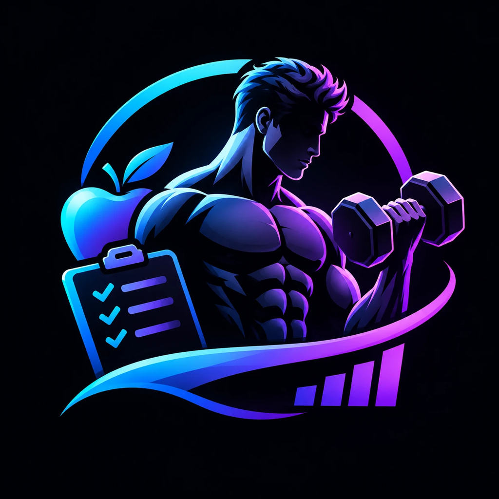

<div align="center">



# Fit Companion

**Your all-in-one gym and nutrition companion for Android: train smarter, eat better and track every step of your progress, in English and Arabic.**


</div>

---

## 📖 About the project

**Fit Companion** is a modern, offline-first fitness app built with Flutter for Android phones. It brings together everything a gym-goer needs in one place: a full workout logger with custom programs, a nutrition tracker with Algerian and Maghreb foods, body and progress tracking, and an **AI coach powered by Google Gemini**. The coach can read your meals from a photo, scan product labels, plan your day of eating, build you a training program and write you a weekly report.

The app was designed for people who train seriously but don't want ten different apps. All your data lives **on your phone** in a local SQLite database, so the app works fully offline. An optional free cloud account (Supabase) adds backup and sync, the AI features and friends.

Fit Companion is **fully bilingual (English / Arabic with right-to-left layout)**. It speaks Algerian Darija in its AI features and knows local dishes like *kesra, chorba, couscous, mhadjeb and garantita*. It ships with **20 themes**, including animated, touch-reactive backgrounds.

Under the hood it is a professional, tested codebase:
- Riverpod state management and go_router navigation
- Drift (SQLite) with versioned migrations and schema tests
- 184 automated tests, including layout tests at 360 px in both languages and both light/dark modes
- WCAG contrast tests for every theme

---

## ✨ Features

### 🏋️ Training
- **Your own programs**: build unlimited custom programs, or copy ready-made templates (PPL, Upper/Lower, Full Body, 5/3/1)
- **Large exercise library** with instructions (EN/AR), muscle groups and equipment, plus custom exercises
- **▶ In-app demo video** for every exercise (YouTube player, looked up once and cached on the server)
- **Live workout logger** with sets, reps and weight, warm-up and drop sets, supersets, RPE and a rest timer that shows in the notification
- **Smart progressive overload** suggestions, plus estimated 1RM and personal-record detection
- **Live coach notes** during the workout: a skipped set, a dropping weight, missed reps, or that you're close to a PR
- **Fatigue and deload detection** from your e1RM trend, RPE and training block length
- **Muscle heatmap** and weekly volume per muscle group
- **Workout summary** with a shareable image card

### 🥗 Nutrition
- Food database with **Algerian/Maghreb dishes**, custom foods, recipes and meal templates
- **Barcode scanner**: local database first, then Open Food Facts, then AI estimation, then reading the label from a photo
- **📸 Meal photo analysis (AI)**: detects every item, estimates grams and macros, and suggests fixes only when needed
- **🎤 Voice logging (AI)**: say what you ate in Darija, Arabic, French or English, and it's logged with its macros
- **🍽️ AI meal plan**: a full day that hits your calorie and macro targets, made from local foods, with a shopping list
- "I ate it" tracking with times, a water tracker and meal reminders
- **Adaptive TDEE**: your *real* maintenance calories, calculated from your intake and weight trend

### 📈 Progress
- Weight and body-fat charts, body measurements
- **Progress photos** with dates, side-by-side comparison and an **AI progress analysis** with tips
- **Sleep and performance** from Health Connect: how your sleep affects your training volume
- Achievements and badges, streaks
- **Challenges and XP levels**: weekly and monthly challenges, from Beginner to Legend

### 🤖 AI coach (Gemini)
- Chat coach that knows your aggregated stats and accepts **photos and videos**
- **Weekly AI report**: a score, what went well, what to improve and goals for next week (optional Friday reminder)
- **AI program builder** that picks only exercises from the app's own catalogue
- Privacy first: only compact summaries are sent, never your name or email; images and audio are not stored

### 👥 Social
- **Friends with a friend code** and a weekly leaderboard (volume, workouts, XP)
- Only your friends can see your stats (Row-Level Security)
- **Shareable image cards** for workouts and levels

### 🎨 Experience
- 20 themes, each with its own shapes (sharp / soft / rounded / pill) and animated, touch-reactive backgrounds
- Full **Arabic RTL** support
- Home-screen widget (calories and water), Health Connect steps and weight sync
- Local backup/restore (JSON), CSV export, optional cloud sync

---

## 🧱 Tech stack

| Layer | Technology |
|---|---|
| UI | Flutter 3.47, Material 3, custom design system (`lib/core/widgets`) |
| State | flutter_riverpod 2.6 |
| Navigation | go_router 14 (`StatefulShellRoute` bottom tabs) |
| Local data | drift 2.24 (SQLite), schema v4 with migrations and `drift_dev` schema tests |
| Charts | fl_chart |
| i18n | `flutter gen-l10n` (ARB files, EN + AR) |
| Device | flutter_local_notifications, mobile_scanner, image_picker, record, health (Health Connect), home_widget, share_plus |
| Backend | Supabase (Auth, Postgres + RLS, Storage, Edge Functions on Deno), free plan |
| AI | Google Gemini (flash models with automatic fallback) called **only** from Edge Functions |

---

## 🗂️ Project structure

```
lib/
├── app/                 # App widget, router
├── core/
│   ├── database/        # Drift tables, AppDatabase, seed and demo data
│   ├── services/        # Cloud (Supabase), notifications, health, backup, widgets…
│   ├── theme/           # 20 palettes, colours, ThemeExtension
│   ├── utils/           # Pure logic: calculators, insights (TDEE, fatigue, sleep, coach notes)
│   └── widgets/         # Design system: AppCard, ProgressRing, animated background…
├── features/
│   ├── dashboard/       # Home
│   ├── workouts/        # Programs, library, active workout, history
│   ├── nutrition/       # Food log, search, barcode, meal photo, recipes
│   ├── progress/        # Weight, measurements, progress photos
│   ├── insights/        # Adaptive TDEE, fatigue, sleep cards
│   ├── challenges/      # Challenges, XP and levels
│   ├── ai/              # Weekly report, program builder, meal plan, voice log
│   ├── social/          # Friends and leaderboard, share cards
│   ├── coach/           # AI coach chat
│   ├── achievements/  hydration/  tools/  profile/  settings/  onboarding/
├── l10n/                # app_en.arb, app_ar.arb (+ generated)
└── shared/              # Shared providers
supabase/
├── functions/           # ai-coach, ai-food-macros, ai-vision, ai-tools (Deno / TypeScript)
└── migrations/          # SQL: tables, RLS policies, storage, friends
test/                    # Unit, widget, layout, contrast and migration tests
tool/                    # Helper scripts (l10n batch import)
```

---

## 🚀 Getting started

### Requirements
- Flutter **3.47+** (Dart 3.13+)
- Android SDK (compileSdk 37, minSdk 26, so Android 8.0+)

### Run
```bash
flutter pub get
flutter run                                    # your real data
flutter run --dart-define=DEMO=true            # demo data in a separate database
flutter run --dart-define=DEMO=true --dart-define=INITIAL_ROUTE=/progress
```

### Develop
```bash
flutter analyze
flutter test
flutter gen-l10n                                            # after editing .arb files
dart run build_runner build --delete-conflicting-outputs    # after changing tables
```

### Build the APK
```bash
flutter build apk --release                    # universal APK
flutter build apk --release --split-per-abi    # smaller APKs (arm64-v8a for most phones)
```
Output: `build/app/outputs/flutter-apk/`

---

## ☁️ Backend (Supabase, optional)

The app works offline without any account. To enable the cloud features with your own Supabase project:

1. Create a free Supabase project and run the SQL files in `supabase/migrations/` in order.
2. Deploy the Edge Functions in `supabase/functions/` (`ai-coach`, `ai-food-macros`, `ai-vision`, `ai-tools`, `exercise-video`) with **verify_jwt disabled**. Each function authenticates the user itself via `auth.getUser()`.
3. Add the secret **`GEMINI_API_KEY`** (free from [Google AI Studio](https://aistudio.google.com)) and **`YOUTUBE_API_KEY`** (YouTube Data API v3, free, for the exercise videos). `GEMINI_MODEL` is optional.
4. In **Authentication → URL Configuration**, set the Site URL and a Redirect URL to `io.fitcompanion://login-callback`.
5. Put your project URL and **publishable** key in `lib/core/services/cloud_service.dart` (`SupabaseConfig`).

> The publishable key is meant to be public: every table is protected by Row-Level Security (`auth.uid() = user_id`), and the AI functions enforce per-user daily limits. The Gemini key never leaves the server.

---

## 🔒 Privacy

- All personal data is stored **locally on the device** by default.
- The AI receives only **aggregated summaries** (no name, no email). Meal photos, progress photos and voice recordings are sent inline for analysis and **are not stored**.
- Friends can only see a few public stats (display name, level, XP, weekly workouts and volume, streak), and only after you exchange codes.

---

## 👨‍💻 Developer

Designed and developed by **Mahdi Hafiane**
